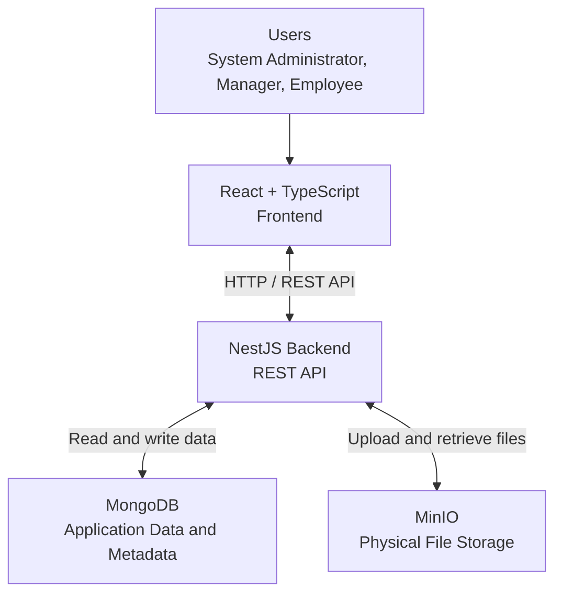

# Architecture — Internal Company Platform

**Version:** 1.0  
**Status:** Initial Architecture Baseline  
**Frontend:** React + TypeScript  
**Backend:** NestJS  
**Database:** MongoDB  
**Object Storage:** MinIO

---

## 1. Overview

### 1.1 Purpose

This document describes the high-level architecture of the Internal Company Platform. It defines the main system components, their responsibilities, and how they communicate with one another.

The architecture is intended to support the implementation of V1 while allowing the platform to evolve in future versions.

### 1.2 Architectural Goals

The architecture aims to provide:

- A modular and maintainable backend.
- Clear separation between presentation, business logic, and data access.
- Secure authentication and authorization.
- Isolation of data belonging to different companies.
- Reliable file storage and retrieval.
- Testable business rules.
- Extensibility for future features.

### 1.3 Architectural Approach

The application will use a **modular monolithic backend** built with NestJS.

The backend will run as one application, organized into feature modules with clearly defined responsibilities. This approach keeps the initial system manageable without introducing the operational complexity of microservices.

---

## 2. Technology Stack

| Technology | Responsibility |
|---|---|
| React | User interface |
| TypeScript | Type safety in the frontend and backend |
| NestJS | Backend application and REST API |
| MongoDB | Application data and file metadata |
| MinIO | Physical file storage |
| HTTP/REST | Communication between frontend and backend |

Additional technologies may be introduced when implementation requirements justify them.

---

## 3. High-Level Architecture

### 3.1 System Components

The system consists of four primary components:

**1. Frontend — React + TypeScript**

Provides the user interface for the System Administrator, Managers, and Employees. It communicates with the backend through HTTP requests.

**2. Backend — NestJS**

Implements business logic, authentication, authorization, validation, and coordination between the database and object storage.

**3. Database — MongoDB**

Stores application data, including company information, user accounts, teams, team memberships, file metadata, file assignments, and security logs.

**4. Object Storage — MinIO**

Stores the physical content of uploaded files. MongoDB stores the associated metadata and storage references rather than the file contents themselves.

### 3.2 Architecture Diagram

The frontend must not access MongoDB directly. Application data and file operations must be handled through authorized backend endpoints.

### 3.3 Communication Flow

A typical request follows this sequence:

1. A user performs an action in the frontend.
2. The frontend sends an HTTP request to the backend.
3. The backend validates the request and authenticates the user when required.
4. Authorization rules are evaluated before protected operations are performed.
5. The appropriate business logic executes.
6. The backend communicates with MongoDB, MinIO, or both, as required.
7. The backend returns the appropriate response to the frontend.

---

## 4. Backend Architecture

### 4.1 Modular Structure

The NestJS backend will be organized into feature modules. Each module will be responsible for a specific area of the application.

The proposed modules are:

| Module | Responsibility |
|---|---|
| AuthModule | Authentication and password management |
| UsersModule | User accounts and profile information |
| CompaniesModule | Company administration |
| CompanyRegistrationRequestsModule | Public registration requests and approval workflow |
| TeamsModule | Team management and team membership |
| FilesModule | File metadata, upload, download, and assignment |
| SecurityLogsModule | Recording and retrieving security events |
| SystemSettingsModule | System-wide configuration |
| CommonModule | Shared utilities and reusable infrastructure, where appropriate |

These names describe the proposed logical structure. The final module boundaries may be refined during implementation.

### 4.2 Internal Layers

Each feature module should separate responsibilities where appropriate.

**Controller**

- Defines API endpoints.
- Receives and validates incoming requests.
- Invokes the relevant service.
- Returns HTTP responses.

**Service**

- Implements business rules and application logic.
- Coordinates operations across repositories or other services.
- Enforces application-level constraints.

**Repository or Data Access Layer**

- Encapsulates database queries and persistence operations.
- Separates database-specific operations from business logic where this provides value.

**Model and DTOs**

- Models describe the application's persisted data structures.
- DTOs define and validate the shape of incoming and outgoing API data where appropriate.

Not every feature requires the same number of classes or layers. The structure should remain consistent without creating unnecessary abstractions.

### 4.3 Dependency Management

NestJS dependency injection will be used to manage dependencies between modules and services.

Modules should expose only the providers that other modules need. Services should depend on clearly defined responsibilities rather than constructing their own dependencies manually.

This supports maintainability, testability, and separation of concerns.

---

## 5. Authentication and Authorization Architecture

### 5.1 Authentication

The backend will authenticate registered users using their username and password.

For the initial V1 implementation:

- The mobile number is used as the username.
- The national identification number is initially used as the password, according to the current requirements baseline.
- Passwords must be stored using an appropriate password-hashing algorithm, never as plaintext.
- Authenticated users must be able to change their passwords.

Using a national identification number as a password is a temporary and weak credential policy. A randomly generated temporary password with a mandatory password change at first login is the planned security improvement.

The specific session or token mechanism will be finalized during authentication design and implementation.

### 5.2 Authorization

Authentication establishes who the user is. Authorization determines which actions and resources the user may access.

The backend must enforce authorization for every protected operation. Hiding a button or page in the frontend is not sufficient security.

Authorization must consider:

- The user's application role.
- The user's company scope.
- The manager's authorized organizational responsibilities.
- Team membership where the operation requires it.
- File ownership or an explicit file assignment.
- Account status and applicable security restrictions.

### 5.3 Roles and Organizational Titles

The application will use `System Administrator`, `Manager`, and `Employee` as application roles, subject to the defined access rules.

All managers use the same application role: `Manager`.

Titles such as Company Manager, Technical Manager, and Finance Manager are organizational or display labels. They are not separate application roles and must not independently grant permissions.

The initial manager is created or activated through the approved company registration workflow.

### 5.4 Company-Level Data Isolation

Company-owned resources must be isolated from other companies.

The backend must verify the relevant company scope when accessing users, teams, files, and other company-owned records. A user must not gain access to another company's resources by changing an identifier in a request.

The isolation rules must be enforced by the backend and covered by automated tests.

---

## 6. File Storage Architecture

### 6.1 Storage Responsibilities

File content and file metadata will be stored separately.

**MongoDB stores:**

- File metadata.
- The associated company and uploader.
- Storage references required to locate the physical file.
- File assignment information and other relevant access-related metadata.

**MinIO stores:**

- The physical content of uploaded files.

The exact document fields and relationships will be defined in `data-model.md`.

### 6.2 File Upload Flow

1. The user submits a file through the frontend.
2. The backend authenticates the user and verifies authorization.
3. The backend validates the upload according to the applicable file policies.
4. The physical file is stored in MinIO.
5. The corresponding metadata and storage reference are persisted in MongoDB.
6. The backend returns the result to the frontend.

The implementation must handle failures between object storage and database operations so that incomplete uploads can be detected and recovered.

### 6.3 File Access and Download Flow

1. The user requests access to a file.
2. The backend authenticates the user.
3. The backend checks whether the user uploaded the file or has an applicable assignment granting access.
4. The backend verifies company isolation and any additional restrictions.
5. If access is permitted, the backend retrieves the file from MinIO or provides an appropriately controlled download mechanism.
6. If access is not permitted, the backend rejects the request.

Team membership alone does not grant access to files uploaded by other team members.

An authorized file assignment grants the recipient permission to view and download the assigned file.

### 6.4 File Assignment and Team Membership

A manager may assign a file only within the manager's authorized scope and to an eligible employee.

Where assignment eligibility depends on team membership, the employee must be an active member of the relevant team.

Removing an employee from a team must not automatically delete existing assignments or revoke previously granted file access solely because the membership ended. Any future change to this policy must be explicitly defined.

### 6.5 Company Deletion and Storage Consistency

Deleting a company affects both MongoDB and MinIO. These systems do not share a single atomic transaction.

The deletion workflow must therefore:

- Prevent unauthorized or cross-company deletion.
- Identify the company's dependent database records and stored objects.
- Track or detect incomplete deletion operations.
- Support retry or recovery when a partial failure occurs.
- Avoid affecting resources belonging to other companies.

The detailed deletion strategy will be finalized during implementation.

---

## 7. Reliability, Security, and Testing

### 7.1 Error Handling

The backend should return consistent HTTP responses and avoid exposing internal implementation details or sensitive information in error messages.

Failures involving database operations, file storage, or authorization must be handled explicitly.

### 7.2 Security Logging

Relevant security events should be recorded, including:

- Failed login attempts.
- Account lockouts and unlocks.
- Important administrative actions.
- Other security-sensitive events defined by the requirements.

Logs must not contain plaintext passwords or other unnecessary sensitive authentication data.

### 7.3 Testing

Automated tests should cover the critical business and security rules, including:

- Authentication and password handling.
- Role-based and scope-based authorization.
- Company-level data isolation.
- Team membership and manager responsibilities.
- File upload, assignment, and download authorization.
- Company deletion and partial-failure recovery.

The implementation should favor isolated unit tests for business logic and integration or end-to-end tests for important API workflows.

---

## 8. Future Extensibility

The initial architecture should allow future features to be added without requiring a complete redesign.

Potential future capabilities include:

- Advanced search and pagination.
- Notifications.
- Task and project management.
- Reporting.
- Real-time communication and video calls.
- Redis- and WebSocket-based features.

These features are not part of the current V1 implementation unless explicitly added to the approved requirements.

Future additions should follow the existing module boundaries and preserve the security and company-isolation principles defined in this document.

---

## 9. Related Documents

- `requirements.md` — Functional and non-functional requirements.
- `use-cases.md` — Actors and use cases.
- `data-model.md` — Data structures and relationships.
- `api-design.md` — API endpoints and request/response contracts.
- `diagrams/` — Architecture and other system diagrams, where applicable.
